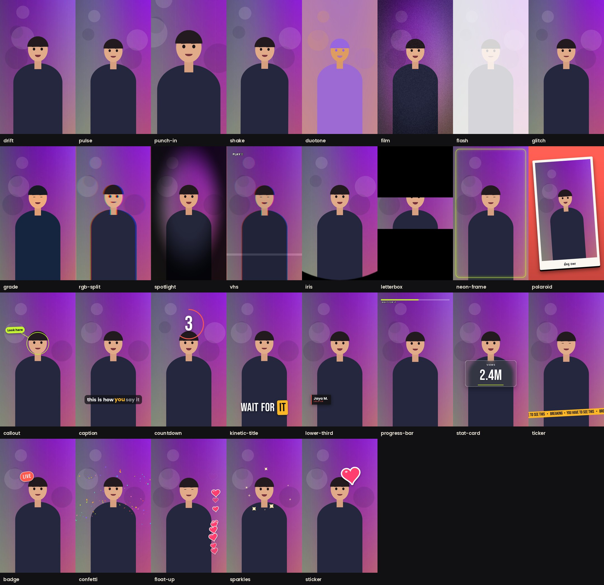

<h1 align="center">Reelcraft</h1>

<p align="center"><b>Effects, stickers and motion graphics for talking-head video.</b><br>
Describe the edit to Claude. It plans it, checks the frames and renders the video.</p>

<p align="center">
  
  
  
  
</p>

<p align="center"></p>
<p align="center"><sub>One plan, ten effects, on the built-in sample clip (an illustrated presenter, not real footage).</sub></p>

---

## Quick start

```bash
git clone https://github.com/Ramakm/claude-video-effects ~/.claude/skills/reelcraft
```

Restart Claude Code, drop a video into the chat and type:

```
/reelcraft punch in when I say "watch this", then a LIVE badge top left
```

The first run sets itself up (about 2 minutes) and installs `ffmpeg` if it's missing.
You get `yourvideo_reelcraft.mp4` next to the original, with your audio untouched.

> Not comfortable with a terminal? Ask Claude: **"Install the skill from github.com/Ramakm/claude-video-effects into ~/.claude/skills/reelcraft"**.

On Windows (PowerShell) use `$HOME\.claude\skills\reelcraft` as the folder. To update, run `git pull` in that folder.

## What you get

29 effects in five layers. They always stack in this order, so you can list them however you like and it still looks right.

| Layer | What it does | Effects |
|---|---|---|
| **Camera** | Moves the picture | `punch-in` `drift` `shake` `pulse` |
| **Look** | Colour, texture, signal damage | `grade` `duotone` `film` `vhs` `glitch` `rgb-split` `spotlight` `flash` |
| **Frame** | Reshapes the shot | `letterbox` `polaroid` `iris` `neon-frame` |
| **Motion** | Animated type and graphics | `kinetic-title` `lower-third` `caption` `callout` `stat-card` `countdown` `ticker` `progress-bar` |
| **Sticker** | Die-cut art and particles | `sticker` (10 designs) `badge` `confetti` `sparkles` `float-up` |

<p align="center"></p>

Every option of every effect is in the [catalog](docs/CATALOG.md).

- **Face-aware.** Titles, stickers and callouts find the speaker's face and stay clear of it.
- **Nothing to license.** Stickers, badges and particles are drawn in code, and the fonts are open-licensed.
- **Stackable.** Combine as many as you like, each with its own start and end time.

## Ask Claude

```
/reelcraft add my name as a lower third for the first 3 seconds, teal-orange grade
/reelcraft finish with confetti and a stat card saying 2.4M views
/reelcraft make it feel like an old camcorder tape, with a glitch on the last second
```

Claude writes a plan, renders a few check frames, fixes anything off (a title over the face, text too small), then renders the full video.

Use your real numbers and words. Stat cards and titles show exactly what you tell Claude.

## Use it from the terminal

No Claude needed:

```bash
cd ~/.claude/skills/reelcraft && bash scripts/setup.sh

reelcraft list                      # every effect, by layer
reelcraft info kinetic-title        # one effect's options

# Check the look in seconds before committing to a render
reelcraft still clip.mp4 -e "kinetic-title@2-5 text='WAIT FOR *IT*'" -e "sticker@2.2-5 name=flame" --at 3 check.png

# Render
reelcraft render clip.mp4 out.mp4 --plan examples/hype-intro.json
```

(Use `.venv/bin/reelcraft` if it isn't on your PATH.)

A plan is plain JSON. Anything besides `fx`, `start` and `end` is an option of that effect:

```json
{"effects": [
  {"fx": "grade", "start": 0, "end": 8, "look": "teal-orange", "strength": 0.8},
  {"fx": "punch-in", "start": 3.8, "end": 5, "zoom": 1.45},
  {"fx": "kinetic-title", "start": 4, "end": 7, "text": "WAIT FOR *IT*"},
  {"fx": "sticker", "start": 4.2, "end": 7, "name": "flame", "at": "top-right"}
]}
```

Starter plans: [`hype-intro`](examples/hype-intro.json), [`results-drop`](examples/results-drop.json), [`retro-tape`](examples/retro-tape.json).
No footage handy? `reelcraft demo demo.mp4` makes the sample clip above.

## How it works

```
video ─► probe ─► face track ─┐
                              ▼
plan.json ─► validate ─► per-frame loop: camera → look → frame → motion → sticker ─► ffmpeg ─► mp4 + original audio
```

- **Registry.** Each effect is one decorated function. The CLI, plan validation, docs and tests all read the same registration, so a new effect needs no other wiring.
- **Pure functions.** An effect depends only on the frame and the clock, never on earlier frames. A `still` is pixel-identical to the same frame in a full render.
- **Face tracking.** OpenCV's bundled cascades on a small proxy of the clip, interpolated and smoothed. No model downloads. If no face is found, effects use a sensible default spot, and `--face x,y,size` pins it by hand.
- **Resolution independent.** Everything is authored at 1080 wide and scaled, so 4K looks like the 1080 render.

## FAQ

**Does it work on landscape video?** Yes. Layouts adapt (for example, `letterbox` picks widescreen bars for landscape and a gentler crop for vertical), but it's tuned for vertical phone video.

**It aimed an effect at the wrong spot.** Tell Claude, or pin the face yourself with `--face 0.5,0.35,0.28` (x, y, size as fractions of the frame).

**Can it time effects to what I say?** Not yet. There's no transcription, so Claude scrubs frames to find the moment, or you give it the time.

**4K?** Add `--width 2160` to `render`. It's slower.

## Honest notes

- This is v0.1: a first draft you review, not a finished edit. Watch it before you post.
- It adds no sound and no speech-to-text captions.
- Face tracking works best with one front-facing speaker in decent light.
- Next up: a person cut-out so titles can sit behind the speaker, transitions between clips, and caption timing from a transcript.

## Contributing

An effect is about 15 lines. See [CONTRIBUTING.md](CONTRIBUTING.md).

## Credits

Made by [Ramakrushna Mohapatra](https://github.com/Ramakm).
Fonts (SIL OFL): Bebas Neue, DM Serif Display, Poppins, Caveat Brush; licences are in [`reelcraft/fonts/`](reelcraft/fonts). Face detection: OpenCV (Apache 2.0). Everything else is MIT, see [LICENSE](LICENSE).
